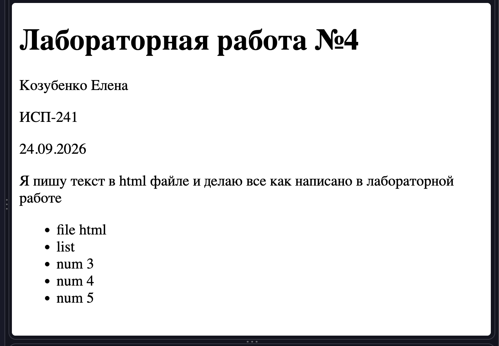
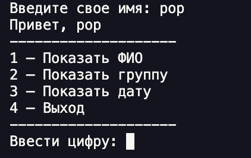
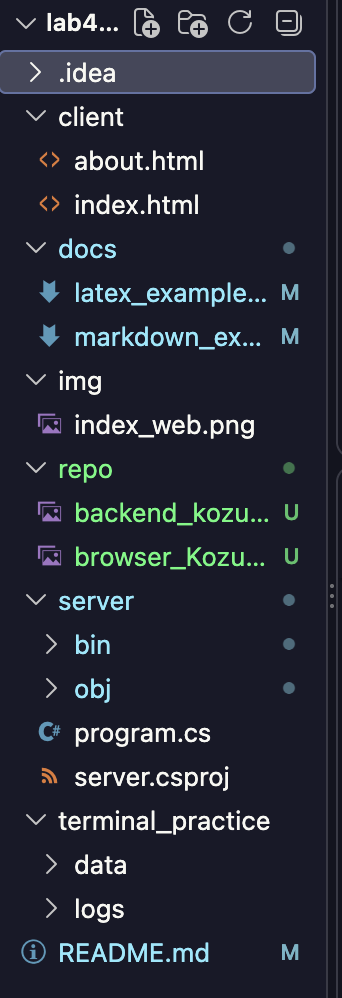
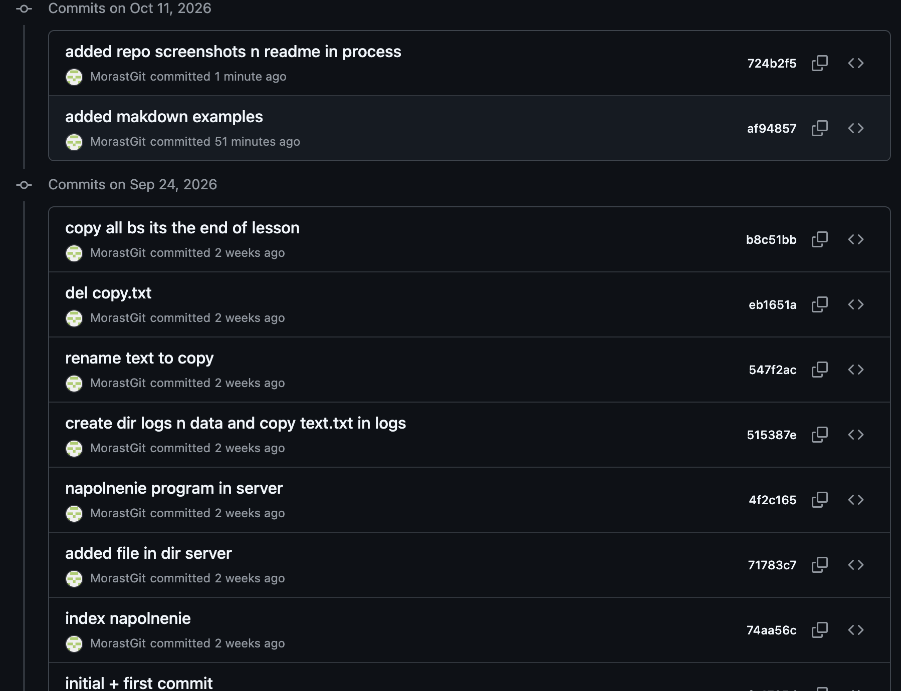

# Лабораторная работа №3: Расширенные возможности Markdown

**Студентка:** Козубенко Елена  
**Группа:** ИСП-241  
**Дата:** 11 октября 2026 г.

---

## Описание проекта

В ходе работы были освоены базовые элементы форматирования, продвинутые конструкции (таблицы, сноски, чекбоксы, Alert-блоки GitHub), а также интеграция математических формул LaTeX и HTML-вставок. 

---

## Содержание

- [Структура проекта](#структура-проекта)
- [Примеры Markdown](#примеры-markdown)
  - [Заголовок](#заголовок)
  - [Список](#список)
  - [Картинка](#картинка)
  - [Код](#код)
- [Пример LaTeX](#пример-latex)
- [Ссылка на репозиторий](#ссылка-на-репозиторий)
- [Скриншоты](#скриншоты)
- [Заключение](#заключение)

---

## Структура проекта

- `README.md` — основной файл документации
- `docs/` — папка с дополнительной документацией
  - `markdown_examples.md` — примеры синтаксиса Markdown
  - `latex_examples.md` - примеры Latex
- `repo/` — папка с изображениями для README
- `img/` — папка со скриншотами
- `idea` - папка с gitignore и другими файлами xml, автоматически была создана Jetbrains IDE так как проект изначально был создан там.
- `client` - содержит html файлы
    - `about.html` - об авторе
    - `index.html` - начальный файл для html
- `server` -  папка, содержащая С# проект
    - `bin` - главная папка проекта, cюда компилятор складывает готовый результат сборки.
    - `obj` - Папка промежуточных объектов. Здесь хранятся временные файлы, которые создаются в процессе компиляции 
    - `program.cs` - исходный код на языке C#
    - `server.csproj` - файл проекта. Cодержит различные настройки, целевую версию .NET, список подключаемых библиотек и файлы, входящие в проект.
    - `terminal_practice` - папка, содержащая в себе две другие папки по файлу в каждой. была использована для тренировки перемещения файлов через терминал, их клонирования
        - `data`
        - `logs`

---

## Примеры Markdown

### Заголовок

### Это пример заголовка H3

### Список

**Маркированный список:**
- Первый пункт
- Второй пункт
  - Вложенный пункт
- Третий пункт

**Нумерованный список:**
1. Первый шаг
2. Второй шаг
3. Третий шаг

### Картинка



### Код

Пример кода на Python:

```python
print("Hello, World!")
```
 ---

## Пример Latex
$a^2 + b^2 = c^2$


$$
\sum_{i=1}^n i = \frac{n(n+1)}{2}
$$

## Ссылка на репозиторий
[ссылка](https://github.com/MorastGit/lab4_isrpo)

## Скриншоты






## Заключение

В ходе выполнения лабораторной работы №3 были изучены и применены возможности Markdown: таблицы, сноски, чекбоксы, Alert-блоки GitHub, LaTeX-формулы, HTML-вставки. Полученные навыки позволяют оформлять техническую документацию, README-файлы для репозиториев и отчёты по проектам.
